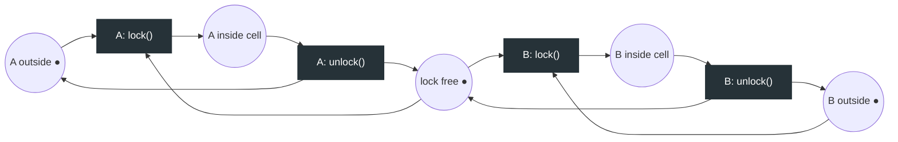
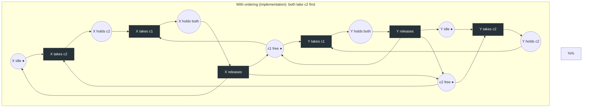
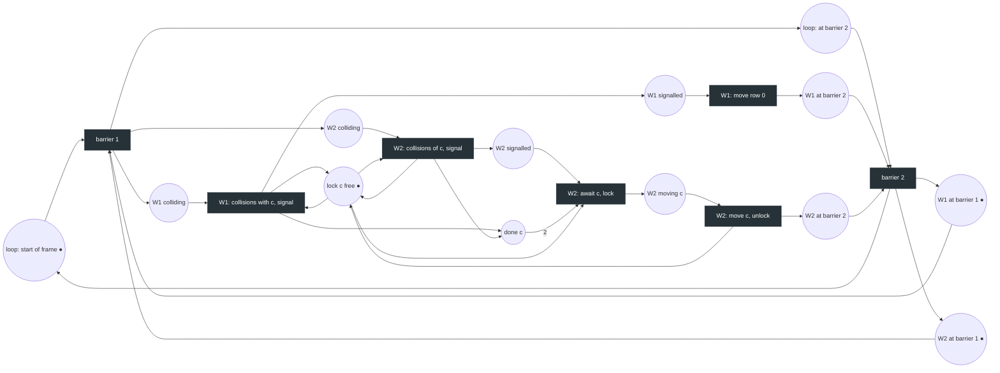
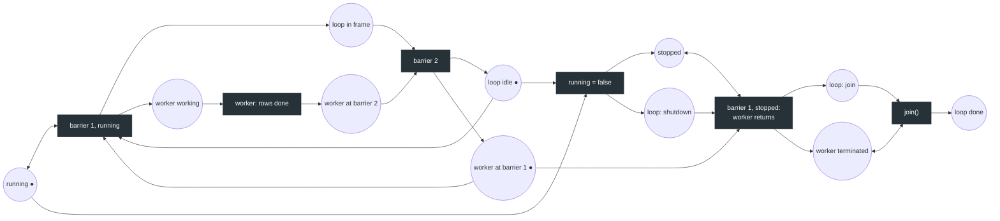
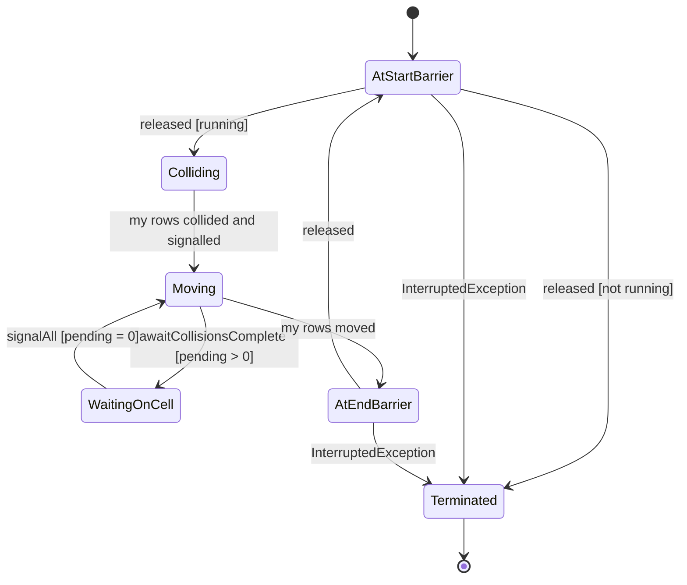

# Behaviour

To model the synchronisation of the physics engine I used **Petri nets**. Each net shows one mechanism: the mutual
exclusion of a cell, the lock ordering, the counter between the two phases, a whole frame, and the termination.

Mermaid does not have Petri nets, so they are drawn as graphs with this convention:

- **places** are circles; `●` is a token in the initial marking;
- **transitions** are dark rectangles;
- an arrow with a number has that **weight** (default 1);
- a double arrow `<-->` is a **read arc**: the transition needs the token but puts it back;
- an arrow ending with a circle `--o` is an **inhibitor arc**: the transition can fire only if the place is empty.

`M(p)` is the number of tokens in the place `p`.

### 1. Mutual exclusion on a Cell
Two threads that use the same cell, for example the worker of row `r-1` (collisions across the border) and the worker
of row `r` (internal collisions). Every method of `Cell` has the shape `lock.lock()`, work, `lock.unlock()`.



**Properties.** `M(lock free) + M(A inside) + M(B inside) = 1` in every reachable marking: at most one thread is
inside the cell (**mutual exclusion**). The net is live: each transition can always fire again.

### 2. Two locks: lock ordering
`resolveCollisionsWith` needs the locks of two cells. Here two threads X and Y both need the cells `c1` (id 1) and
`c2` (id 2). On the left, each thread takes the locks in its own order; on the right, as in the code, both take the
lock with the higher id first.



**Properties.** Without ordering, the marking {X holds c1, Y holds c2} is reachable and no transition is enabled:
it is a **deadlock**. With ordering, the thread that takes `c2` first is the only one that can take `c1`, and the
other is still idle; every reachable marking enables at least one transition, so there is **no deadlock**. The same
argument works with any number of cells, because the ids give a total order on all the locks.

[//]: # (### 3. The counter between the two phases)

[//]: # (This net models one cell of a row `r ≥ 1` during one frame. The collision work of rows `r-1` &#40;job 1&#41; and `r` &#40;job 2&#41;)

[//]: # (must signal the cell before the worker of row `r` can move its balls.)

[//]: # ()
[//]: # (```mermaid)

[//]: # (flowchart LR)

[//]: # (    D&#40;&#40;"game loop ●"&#41;&#41;)

[//]: # (    P&#40;&#40;"pending"&#41;&#41;)

[//]: # (    J1w&#40;&#40;"job 1 working"&#41;&#41;)

[//]: # (    J1d&#40;&#40;"job 1 done"&#41;&#41;)

[//]: # (    J2w&#40;&#40;"job 2 working"&#41;&#41;)

[//]: # (    J2d&#40;&#40;"job 2 done"&#41;&#41;)

[//]: # (    Mw&#40;&#40;"mover waiting"&#41;&#41;)

[//]: # (    Mm&#40;&#40;"mover moving"&#41;&#41;)

[//]: # ()
[//]: # (    tB["initFrame&#40;2&#41;"]:::tr)

[//]: # (    tS1["job 1: signalCollisionsDone&#40;&#41;"]:::tr)

[//]: # (    tS2["job 2: signalCollisionsDone&#40;&#41;"]:::tr)

[//]: # (    tP["mover: await returns"]:::tr)

[//]: # ()
[//]: # (    D --> tB)

[//]: # (    tB -- "2" --> P)

[//]: # (    tB --> J1w)

[//]: # (    tB --> J2w)

[//]: # (    tB --> Mw)

[//]: # ()
[//]: # (    J1w --> tS1)

[//]: # (    P --> tS1)

[//]: # (    tS1 --> J1d)

[//]: # ()
[//]: # (    J2w --> tS2)

[//]: # (    P --> tS2)

[//]: # (    tS2 --> J2d)

[//]: # ()
[//]: # (    Mw --> tP)

[//]: # (    P --o tP)

[//]: # (    tP --> Mm)

[//]: # ()
[//]: # (    classDef tr fill:#263238,color:#ffffff,stroke:#263238)

[//]: # (```)

[//]: # ()
[//]: # (`initFrame&#40;2&#41;` puts two tokens in `pending` &#40;the counter `pendingCollisionWorkers`&#41;. Each signal removes one. The)

[//]: # (transition `await returns` is the exit from `while &#40;pendingCollisionWorkers > 0&#41; collisionsComplete.await&#40;&#41;;`: the)

[//]: # (inhibitor arc means it can fire only when `pending` is empty.)

[//]: # ()
[//]: # (**Properties.**)

[//]: # ()
[//]: # (- `M&#40;pending&#41; + M&#40;job 1 done&#41; + M&#40;job 2 done&#41; = 2`: the counter is never negative and never larger than 2.)

[//]: # (- `mover moving` can be marked only after both signals: the balls of a cell never move while a collision job that)

[//]: # (  touches that cell is still running.)

[//]: # (- From every reachable marking the mover can eventually move, because the jobs never wait before signalling: there is)

[//]: # (  no deadlock between the two phases.)

[//]: # ()
[//]: # (The same cell as a state diagram:)

[//]: # ()
[//]: # (```mermaid)

[//]: # (stateDiagram-v2)

[//]: # (    [*] --> Colliding: initFrame&#40;k&#41;, pending = k)

[//]: # (    Colliding --> Colliding: signalCollisionsDone&#40;&#41; [pending > 1])

[//]: # (    Colliding --> Movable: signalCollisionsDone&#40;&#41; [pending = 1] / signalAll&#40;&#41;)

[//]: # (    Movable --> Moved: updateMovement&#40;&#41;)

[//]: # (    Moved --> Colliding: initFrame&#40;k&#41; of the next frame)

[//]: # (```)

### 4. A whole frame
The full protocol for the smallest interesting case: the game loop, two workers (W1 owns row 0, W2 owns row 1) and a
cell `c` of row 1, touched by the collision work of both workers. The barrier is a transition with one input arc from
each member: it fires only when all three are waiting. The collision work on `c` is drawn as one step that uses the
lock of `c` and produces one token in `done c`.



**Properties.**

- `M(lock c free) + M(W2 moving c) = 1`: mutual exclusion on `c`.
- `M(done c) ≤ 2`, and the arc of weight 2 empties it, so the counter starts from zero at every frame.
- W2 can move `c` only after both collision steps on `c`. W1 can already move row 0 while W2 is still colliding:
  there is no global barrier between the two phases.
- From every reachable marking the initial marking can be reached again: every frame completes and the cycle repeats
  (**liveness**, no deadlock).

### 5. Termination
The game loop and one worker. The place `running` models the `running` flag. The barrier transitions read it to decide
whether the worker starts a new frame or terminates.



**Properties.** After `running = false`, the only possible sequence is release, return of the worker, join, ending in
{loop done, worker terminated, stopped}. This final marking is the expected end of the program, not a deadlock. The
worker can no longer start a frame, because `barrier 1, running` needs the token in `running`. Without the flag and
the last release, the worker would stay in `worker at barrier 1` forever after the last frame, which is exactly what
JPF reported for the first test harness (see [Model Checking](model-checking.md)).

The life of a worker as a state diagram:


