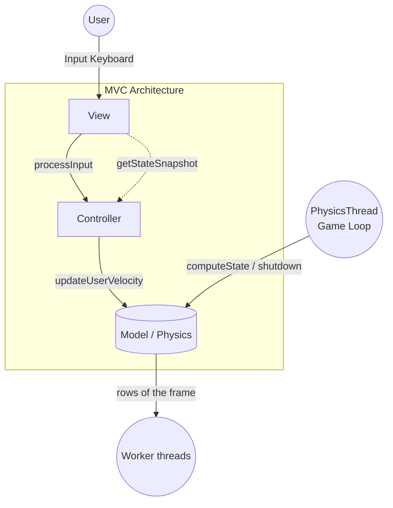
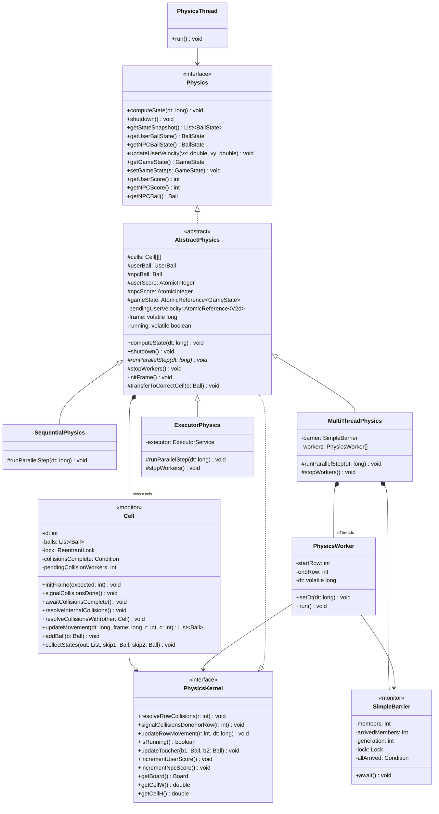
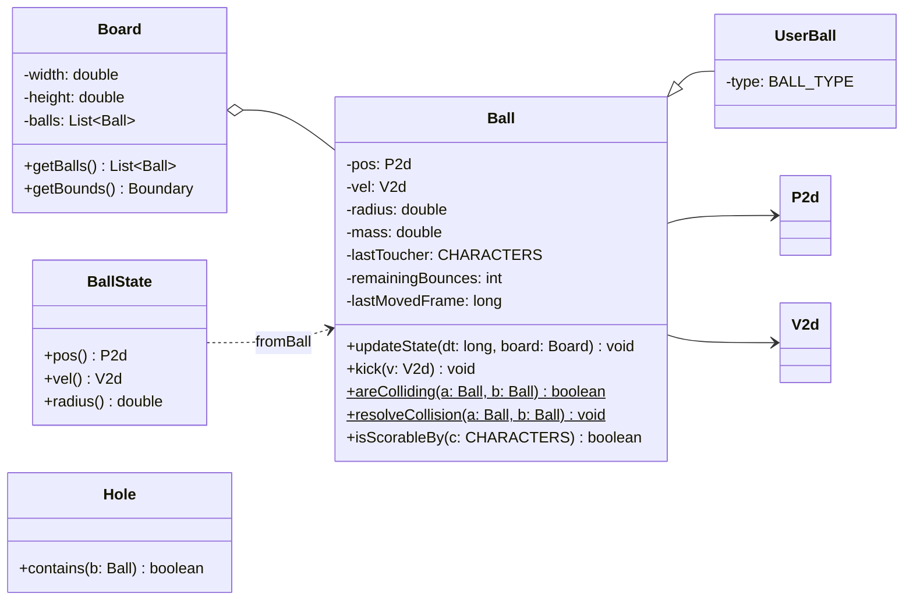
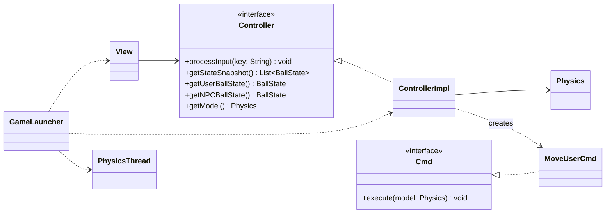
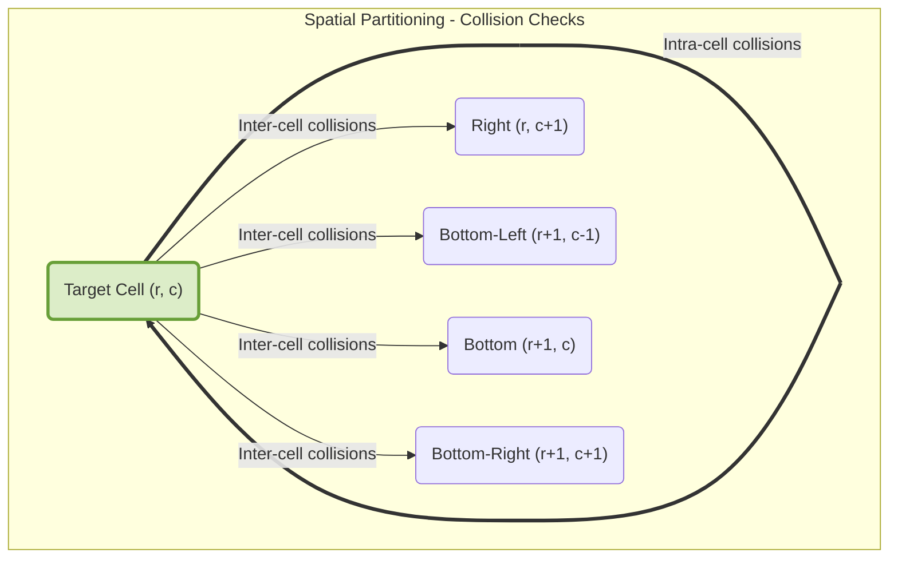
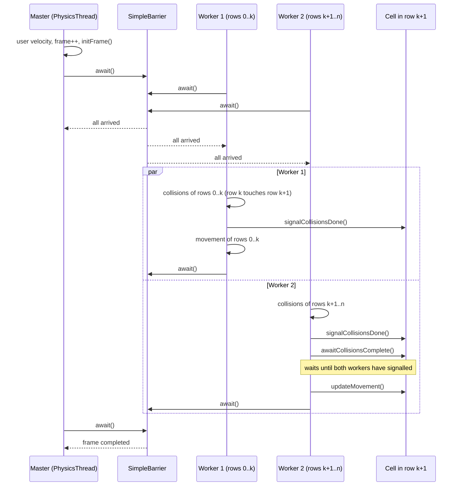
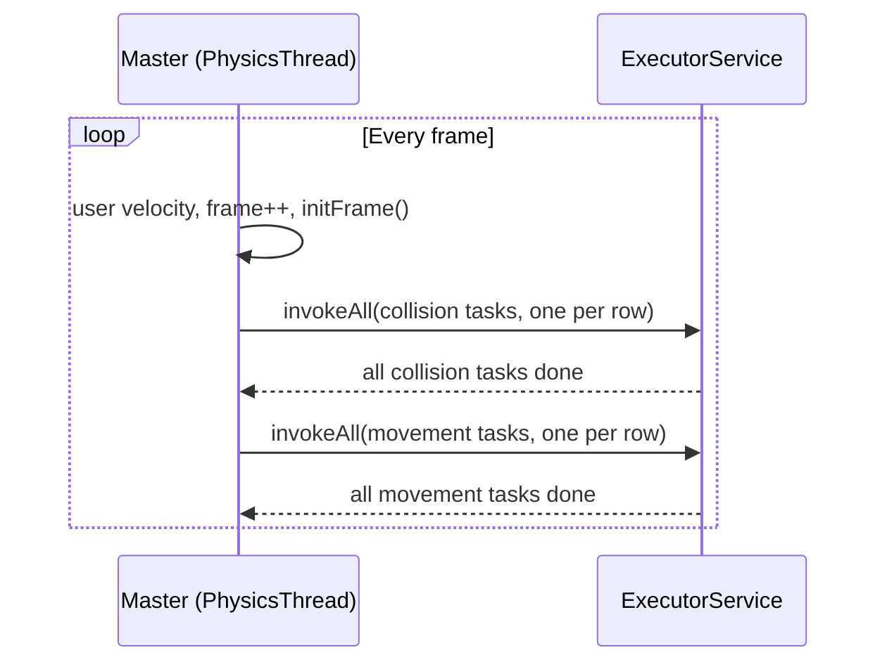
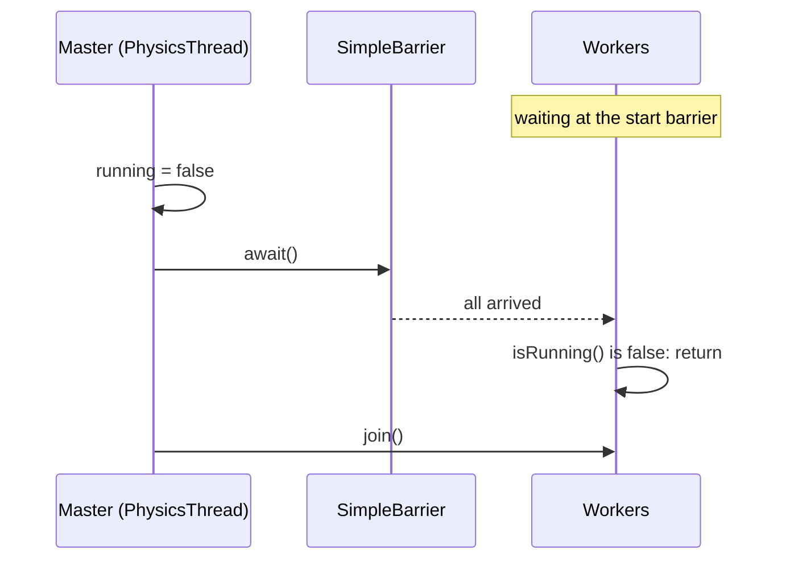

# Design

### System Architecture
The system follows the Model-View-Controller (MVC) pattern. The **Model** contains the physics simulation, the spatial
grid and the entities, and does not depend on the graphical interface. The **View** is a Swing window that repaints
the board every 16 ms, reading the state of the balls through the Controller. The **Controller** receives the key
presses from the View and turns them into commands for the Model.

The game loop runs in a dedicated thread, `PhysicsThread`. At each tick it moves the NPC ball, calls
`computeState(dt)` on the model, checks if the game is over and sleeps for the rest of the 16 ms period. It is the
only thread that calls `computeState`; when the loop ends it calls `shutdown()`, which stops the worker threads.



There are three kinds of threads:

| Thread | What it does |
|---|---|
| Swing EDT | draws the board, receives the key presses |
| `PhysicsThread` | game loop: calls `computeState` every 16 ms and `shutdown` at the end |
| workers | compute the rows of a frame (only in the multithreaded and executor versions) |

### Class Diagrams

The model exposes two interfaces. `Physics` is the public one, used by the Controller and the game loop.
`PhysicsKernel` contains the methods used inside the engine by the cells and by the workers (per-row work, scores,
holes, cell size). `AbstractPhysics` implements both and contains everything the three engines have in common: the
grid of cells, the per-row work and the frame logic. Each engine only decides who executes the rows.



The entities are simple classes. `P2d`, `V2d`, `BallState`, `Hole` and `Boundary` are immutable, so they can be
shared between threads. They are written as normal final classes instead of records so that the code compiles with
Java 11, which is needed by Java PathFinder. `Ball` is mutable and is protected by the lock of the cell that contains
it.





### Spatial Decomposition
The board is divided into a grid of cells, and each ball is assigned to the cell that contains its centre.

To check every pair of adjacent cells exactly once, collision checks are directional: the cell `(r, c)` checks its own
balls and four neighbours only, Right, Bottom-Left, Bottom and Bottom-Right. The other neighbours (Left, Top-Left,
Top, Top-Right) are checked by the jobs of those cells.



A consequence is that the collision work of row `r` touches only the cells of rows `r` and `r+1`. So a cell of row
`r` is touched by the collision work of two rows, `r-1` and `r` (only one for row 0). This number is used by the
synchronisation between the two phases.

### The Cell Monitor
Each `Cell` is a monitor implemented with a `ReentrantLock` and a `Condition`. The lock, the list of balls and the
counter are private: every operation on the cell goes through one of its methods, and every method takes the lock
with the usual pattern:

```java
lock.lock();
try {
    ...
} finally {
    lock.unlock();
}
```

| Method | Used by | Description |
|---|---|---|
| `initFrame(expected)` | game loop, at the start of the frame | sets `pendingCollisionWorkers` to 1 (row 0) or 2 |
| `resolveInternalCollisions()` | collision phase | collisions among the balls of the cell |
| `resolveCollisionsWith(other)` | collision phase | collisions with an adjacent cell; takes **both** locks |
| `signalCollisionsDone()` | collision phase | decrements the counter, `signalAll()` when it reaches 0 |
| `awaitCollisionsComplete()` | movement phase | waits on the condition while the counter is > 0 |
| `updateMovement(dt, frame, r, c)` | movement phase | moves the balls, handles the holes, returns the balls that left the cell |
| `addBall(b)` | movement phase, set-up | adds a ball to the cell |
| `collectStates(...)` | View (through the Controller) | copies the state of the balls for drawing |

The wait on the condition is in a `while` loop, so the condition is checked again after every wake-up (also in case
of spurious wake-ups):

```java
public void awaitCollisionsComplete() throws InterruptedException {
    lock.lock();
    try {
        while (pendingCollisionWorkers > 0) {
            collisionsComplete.await();
        }
    } finally {
        lock.unlock();
    }
}
```

**Two locks without deadlock.** `resolveCollisionsWith` is the only method that holds two cell locks at the same time.
It always takes the lock of the cell with the higher id first. Since all threads take the locks in the same order, two
threads can never wait for each other in a cycle:

```java
Cell first = this.id > other.id ? this : other;
Cell second = (first == this) ? other : this;
first.lock.lock();
try {
    second.lock.lock();
    try {
        // collisions between this.balls and other.balls
    } finally {
        second.lock.unlock();
    }
} finally {
    first.lock.unlock();
}
```

All the other methods take only one lock, and while holding it a cell never calls a method that takes another lock or
blocks (the scores are `AtomicInteger`s and the game state is an `AtomicReference`).

**Real collisions only.** Before updating the "last toucher" of two balls, the cell checks `Ball.areColliding`. Without
this check, every ball in a cell next to the user ball was marked as touched by the user, even without contact.

**Every ball moves once per frame.** When a ball leaves a cell during the movement phase, it is added to the cell that
now contains it. If that cell has not moved its balls yet in this frame, the ball would be moved a second time. To
avoid this, every `Ball` remembers the number of the last frame in which it was moved (`lastMovedFrame`), and
`updateMovement` skips the balls that have already been moved in the current frame:

```java
if (b.getLastMovedFrame() == frame) {
    continue;
}
b.setLastMovedFrame(frame);
b.updateState(dt, this.model.getBoard());
```

### The SimpleBarrier Monitor
`SimpleBarrier` is a reusable barrier implemented with a `ReentrantLock` and a `Condition`. A `generation` counter
lets the same barrier be used for every frame: a thread waits until the generation changes, so a thread arriving at
the next use of the barrier cannot be confused with the previous one.

If a thread is interrupted while waiting and the barrier has not been passed yet, it withdraws its arrival
(`arrivedMembers--`) and throws `InterruptedException`, so the count stays correct for the other threads. If the
barrier has already been passed, the thread goes on and keeps its interrupt flag.

### The Frame
At every tick the game loop calls `computeState(dt)`:

1. it applies the velocity requested by the user, if any;
2. it increments the frame number;
3. it resets the counter of every cell (`initFrame`);
4. it calls `runParallelStep(dt)`, implemented by the engine.

Steps 1-3 are done while the workers are waiting at the barrier, so they cannot interfere with a running frame.

The work of each row has two phases:

1. **Collision phase:** `resolveRowCollisions(r)`, then `signalCollisionsDoneForRow(r)`, which signals the cells of
   rows `r` and `r+1`.
2. **Movement phase:** `updateRowMovement(r, dt)`: for every cell of the row it waits until the counter of the cell is
   0 (the collision work of rows `r-1` and `r` is finished), then moves its balls and transfers the balls that left
   the cell.

There is no global barrier between the two phases: a cell waits only for the rows that touch it, so a worker can start
moving its rows while another worker is still computing collisions elsewhere.

#### 1. Sequential Implementation
The game loop thread executes the collision phase of all the rows and then the movement phase of all the rows. When
the movement starts all the counters are already 0, so the thread never waits. It is the baseline for the performance
evaluation.

#### 2. Multithreaded Implementation (Platform Threads)
A fixed number of `PhysicsWorker` threads (by default `Runtime.getRuntime().availableProcessors()`) is created when
the engine is created. Each worker is assigned a contiguous block of rows. The game loop and the workers meet on a
`SimpleBarrier` with `nThreads + 1` members, twice per frame: at the start (to release the workers) and at the end
(to wait for them).



#### 3. Executor-Based Implementation
The third implementation uses an `ExecutorService` with a fixed thread pool. At each frame the game loop creates one
`Callable` per row for the collision phase and calls `invokeAll`, which returns when all the tasks are finished. Then
it does the same with the movement tasks. `invokeAll` acts as a barrier between the two phases, so the counters of
the cells are already 0 when the movement starts.



### Termination
`AbstractPhysics` has a `volatile boolean running` flag. When the game loop ends (game over or interrupted), it calls
`shutdown()` in a `finally` block:

- `MultiThreadPhysics`: sets `running = false` and calls `barrier.await()` once more. The workers, which are waiting
  at the start of the next frame, are released, see that `running` is false and return. Then the game loop `join`s
  them.
- `ExecutorPhysics`: sets `running = false` and calls `executor.shutdown()`.



### Input, Rendering and Scores
- **User input.** The key presses arrive on the EDT. `updateUserVelocity` does not write the velocity of the ball
  directly (a worker could be updating the same ball): it stores it in an `AtomicReference`, and `computeState` applies
  it at the start of the next frame, while the workers are waiting at the barrier. The NPC ball is kicked by the game
  loop thread, also between two frames.
- **Rendering.** The View gets the balls with `getStateSnapshot()`, which calls `collectStates` on every cell, one cell
  at a time, under the lock of the cell.
- **Scores.** The scores are `AtomicInteger`s updated with `incrementAndGet()`, so two cells scoring at the same time
  do not lose a point.

### Known Limitations
- If a worker throws an exception, it dies and the other threads wait forever at the barrier or on a cell. The
  executor version ignores the exceptions of the tasks (`invokeAll` stores them in the `Future`s, which are not
  checked).
- A ball that moves into a cell of a row whose collisions are still being computed takes part in those collisions.
  This does not corrupt anything, because every access is done under the lock of the cell.
- The View reads the state cell by cell while the workers may be moving balls, so a ball crossing a border can be
  drawn twice or not at all for one frame. The positions of the two big balls are read without a lock (the positions
  are immutable `P2d` objects, so the View sees an old or a new position, never a broken one).
- The engine must be stopped with `shutdown()`, not by interrupting the worker threads.
